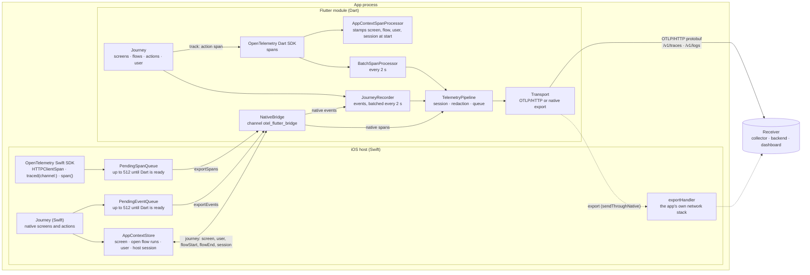
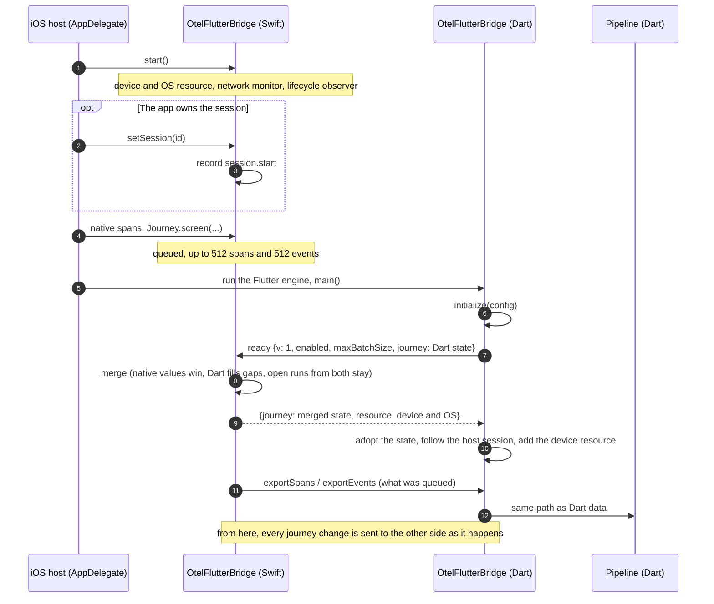
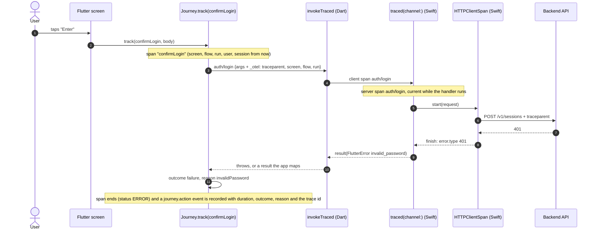
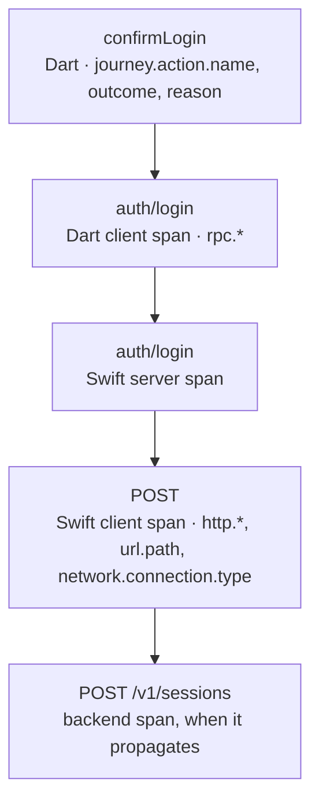
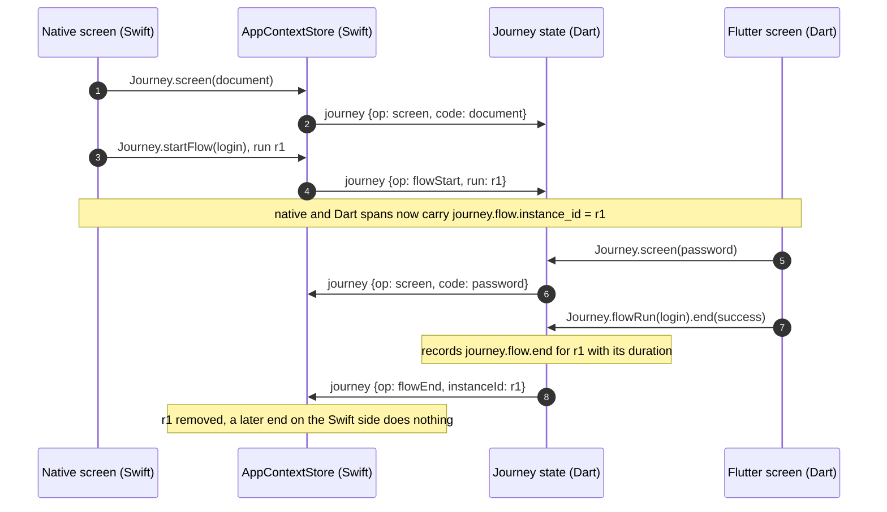
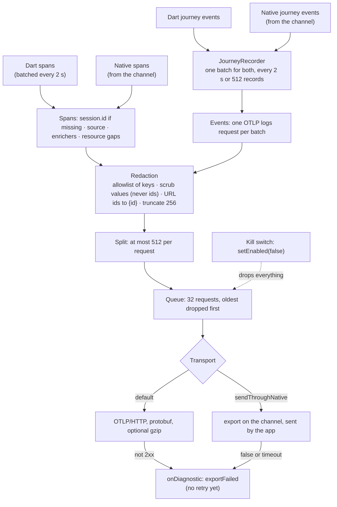
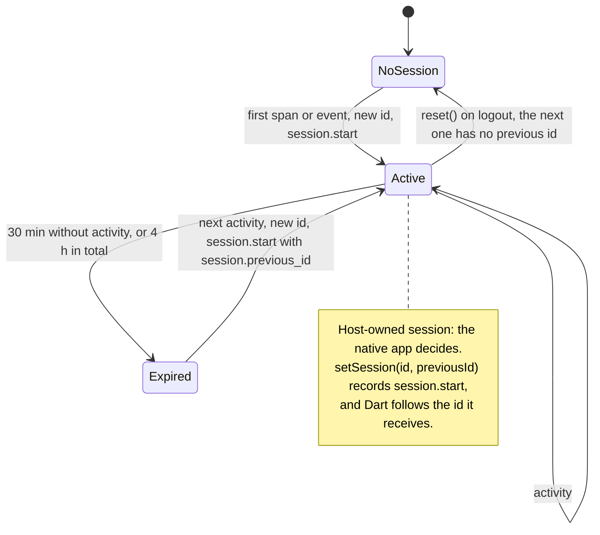
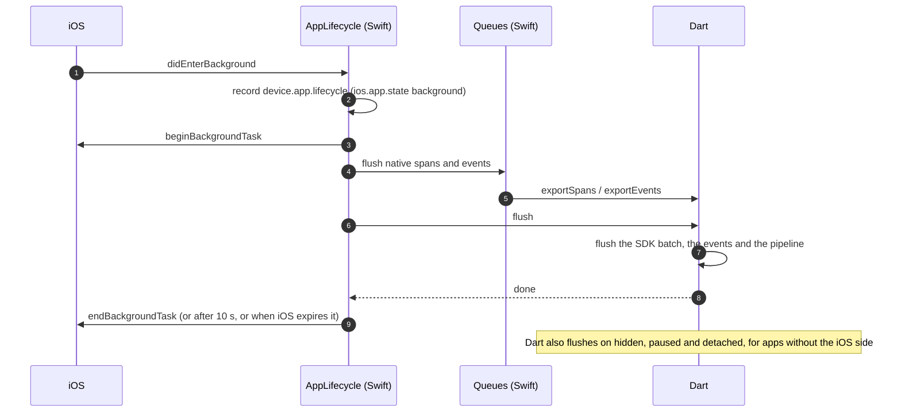
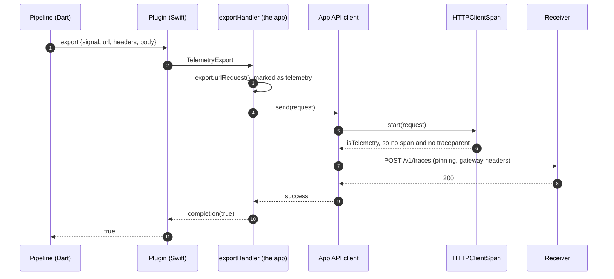
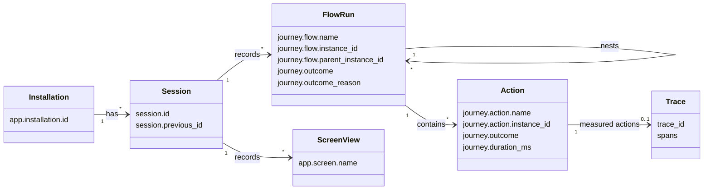

# Architecture, in diagrams

How the library works inside an add-to-app Flutter app with an iOS host.
Each diagram links to the spec that defines it. The diagrams are Mermaid
(GitHub draws them); the text stays readable without rendering.

For the dashboard side (receiver, aggregator, storage, UI), see
[architecture.md](https://github.com/luizroddev/otel-journey-dashboard/blob/main/docs/architecture.md)
in `otel-journey-dashboard`. For adopting both in an existing system, see the
[adoption guide](adoption-guide.pt-BR.md) (Portuguese).

1. [Components](#1-components)
2. [Startup and the ready handshake](#2-startup-and-the-ready-handshake)
3. [One action, end to end](#3-one-action-end-to-end)
4. [One journey across Swift and Dart](#4-one-journey-across-swift-and-dart)
5. [The pipeline](#5-the-pipeline)
6. [Sessions](#6-sessions)
7. [Leaving the foreground](#7-leaving-the-foreground)
8. [Sending through the app's network stack](#8-sending-through-the-apps-network-stack)
9. [What a session looks like as data](#9-what-a-session-looks-like-as-data)

## 1. Components

Everything leaves the device from **one pipeline, in Dart**. The Swift side
records, queues until Dart is ready, and hands spans and events over the
platform channel ([native-bridge.md](specs/native-bridge.md),
[ADR 0005](adr/0005-where-the-pipeline-lives.md)).

| Piece | Where | Spec |
|---|---|---|
| `Journey` (Dart and Swift) | `lib/src/journey.dart`, `ios/Classes/Journey.swift` | [journey.md](specs/journey.md) |
| `TelemetryPipeline` | `lib/src/pipeline.dart` | [failure-and-limits.md](specs/failure-and-limits.md) |
| Redaction | `lib/src/redaction.dart` | [redaction.md](specs/redaction.md) |
| Session | `lib/src/session.dart` | [session.md](specs/session.md) |
| Channel, queues, shared state | `lib/src/native_bridge.dart`, `ios/Classes/` | [native-bridge.md](specs/native-bridge.md) |

## 2. Startup and the ready handshake

Native code can record before the Flutter engine runs. Nothing is lost: it
waits in bounded queues and joins the same session once Dart says it is
ready. Both sides then hold the same journey state.

## 3. One action, end to end

`Journey.track` makes one span for the action. The channel call, the native
code and the HTTP request become its children, and the backend continues the
same trace through `traceparent`
([native-bridge.md](specs/native-bridge.md#trace-context-across-the-channel)).
The journey event of the action carries the trace id, so the dashboard opens
the tree from the step.

The resulting tree:

## 4. One journey across Swift and Dart

The current screen, the open flow runs and the user are shared. Each side
applies a change locally and sends it to the other, which applies it
without sending it back. Either side can end a run; only the first end
counts ([journey.md](specs/journey.md#one-journey-across-both-sides)).

## 5. The pipeline

Every span and event takes the same path before leaving the device
([redaction.md](specs/redaction.md),
[failure-and-limits.md](specs/failure-and-limits.md)).

## 6. Sessions

The library owns the session by default. With
`SessionConfig(fromHost: true)`, the native app owns it and calls
`setSession` ([session.md](specs/session.md)).

## 7. Leaving the foreground

The last seconds before the user leaves are often the ones worth
investigating, so everything pending is sent before the app is suspended
([failure-and-limits.md](specs/failure-and-limits.md#leaving-the-foreground)).

## 8. Sending through the app's network stack

With `sendThroughNative`, the app's own client sends the telemetry
(certificate pinning, gateway headers, mutual TLS). The request is marked,
so the app's HTTP instrumentation never traces it
([native-bridge.md](specs/native-bridge.md#sending-through-the-apps-network-stack)).

## 9. What a session looks like as data

- Screen views, flow starts and ends, instant actions and lifecycle changes
  are **log records** with an event name.
- Measured actions are a **span** plus a `journey.action` event that
  carries the span's trace id.
- `user.id` is on everything after the login. `device.id` is stamped by the
  receiver, never sent by the app.
